<div align="center">

# Kaasu

**A personal UPI spending tracker for Android.**
Tag every payment before you pay, stay inside a daily budget, and get a weekly report card.

*Kaasu (காசு) is Tamil for money.*

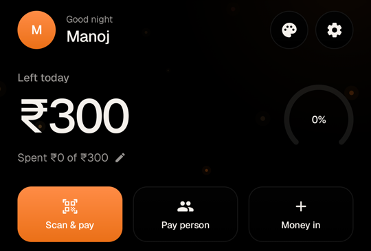

</div>

---

## What it does

Kaasu sits in front of your UPI app. You scan a QR or pick a person in Kaasu, type the amount, and choose what it's for. Then your UPI app (PhonePe, GPay, Paytm, super.money, BHIM) opens with everything filled in. You only enter your UPI PIN there, and Kaasu takes you straight back with no questions after you pay.

- **Daily budget**: see what's left today, with a warning (not a block) when you go over.
- **What's it for, in one tap**: categories are ordered by time of day, so Breakfast and Petrol come first in the morning and Snacks in the evening.
- **Automatic tracking**: bank SMS and UPI app alerts confirm payments and catch money you receive.
- **History**: every payment with its transaction ID and UTR.
- **People and lending**: track who owes you; repayments are matched automatically.
- **Weekly report card**: marks out of 100 for staying under budget, snacks, spending vs last week, money lent, three meals a day and saving vs last month, with tips. Share it as an image.
- **Check balance**: a free SBI missed call, and the reply SMS updates your balance.
- **App lock**: PIN or fingerprint, never asked right after you pay.
- **Home screen widget and shortcuts**: scan and pay from the home screen.

## Styles

Pick a style from the palette button on Home. The whole app, its live wallpaper and the app icon change with it. Every style is built from three colours (base, ink and accent), and none of them use cards.

<div align="center">
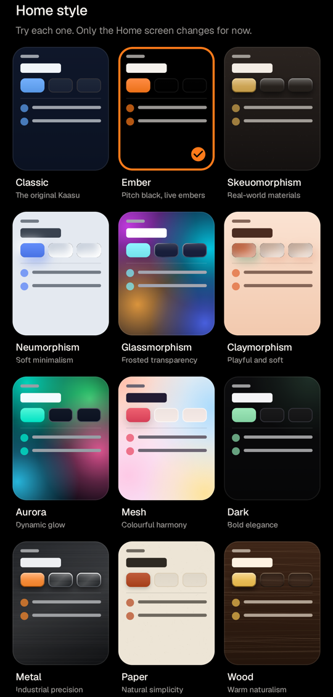
</div>

| | | |
|:-:|:-:|:-:|
| <br>**Ember**<br>Pitch black, live embers | 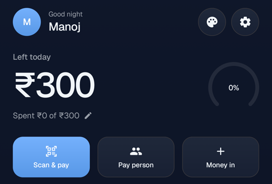<br>**Classic**<br>The original Kaasu | 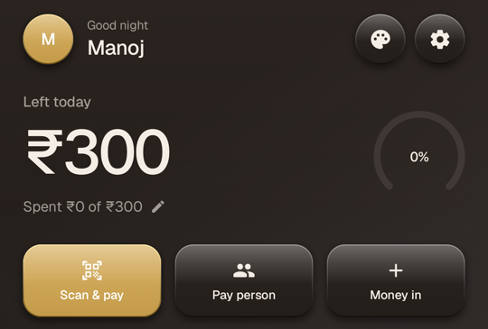<br>**Skeuomorphism**<br>Real-world materials |
| 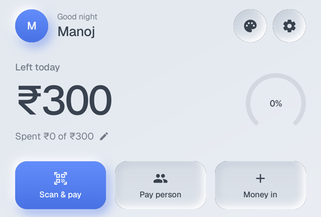<br>**Neumorphism**<br>Soft minimalism | 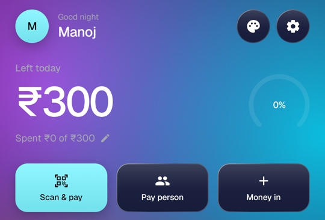<br>**Glassmorphism**<br>Frosted transparency | 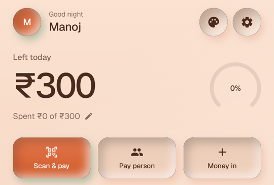<br>**Claymorphism**<br>Playful and soft |
| 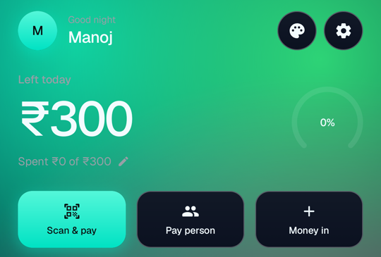<br>**Aurora**<br>Dynamic glow | 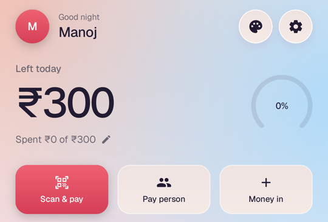<br>**Mesh**<br>Colourful harmony | 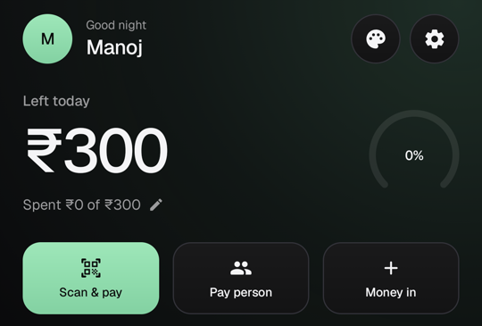<br>**Dark**<br>Bold elegance |
| 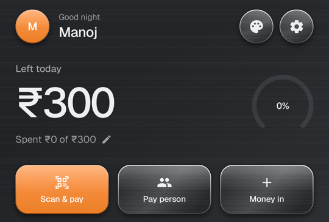<br>**Metal**<br>Industrial precision | 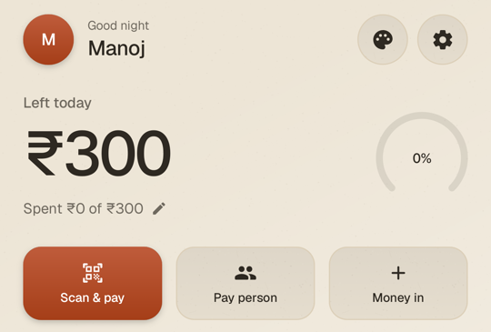<br>**Paper**<br>Natural simplicity | 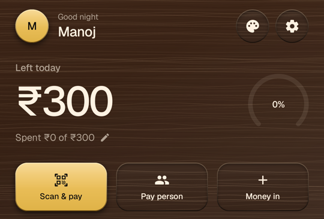<br>**Wood**<br>Warm naturalism |
| 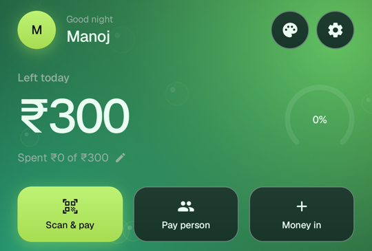<br>**Bio-morphism**<br>Inspired by nature | 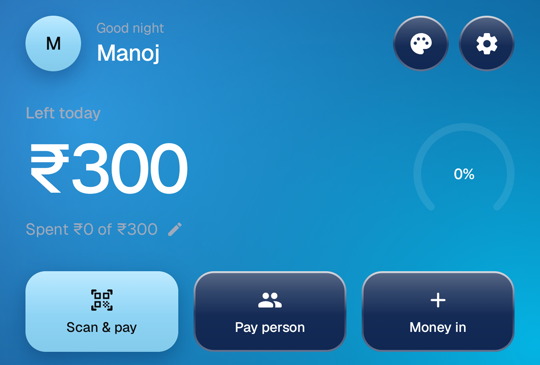<br>**Liquid Glass**<br>Fluid clarity | 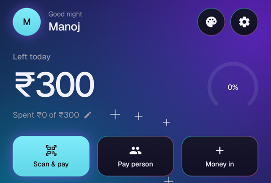<br>**AI Morphism**<br>Intelligent glow |

### Motion

- A frosted-glass tab bar whose selected-tab lens slides on a spring and stretches as it moves.
- Every button dips on touch and springs back.
- Tabs glide in the direction of the tab. Inner screens push in from the right while the old one drifts back.
- Ticking a meal plays a short eating animation: bites, crumbs, then a tick.
- On Home, the amount left, the balance and the score dock into a top bar as you scroll.
- The live wallpaper freezes on a still frame when the phone's animations are turned off.

## Privacy

- **No internet permission.** Kaasu can't send anything off the phone.
- Everything (payments, people, settings) is stored only on the device.
- SMS and notification reading are optional. Only bank SMS and alerts from known UPI apps are read; everything else is ignored before its text is read.
- Backup and restore go to a file you choose.

## How payments work

Kaasu never handles money or your UPI PIN. Only NPCI-approved apps may show the PIN screen, so Kaasu builds a standard `upi://pay` link and hands it to the UPI app you choose. A payment is saved as *Pending* first, then confirmed from the UPI app's response, the bank SMS or the app's alert.

## Build

Requirements: Android Studio (or the command-line tools), JDK 17, Android SDK 36.

```bash
# Debug build
./gradlew :app:assembleDebug

# Unit tests
./gradlew :app:testDebugUnitTest

# Release build (needs your own signing key, see below)
./gradlew :app:assembleRelease
```

Release signing reads `keystore.properties` from the project root. That file and the keystore are git-ignored on purpose:

```properties
storeFile=kaasu-release.keystore
storePassword=...
keyAlias=...
keyPassword=...
```

The `fakeupi` module is a test-only stand-in for a UPI app. It shows the link it received and replies with success or failure.

## Tech

| Area | Used |
|---|---|
| UI | Kotlin, Jetpack Compose, Material 3 |
| Architecture | MVI, Hilt, Room, DataStore, WorkManager |
| Camera and QR | CameraX, ML Kit barcode scanning |
| Blur | [Haze](https://github.com/chrisbanes/haze) |
| Font | [Geist](https://github.com/vercel/geist-font) (SIL Open Font License) |
| Min / target SDK | 26 / 36 |

## Project layout

```
app/src/main/java/com/manoj/kaasu/
├── core/          money, dates, PIN hashing
├── data/          Room database, settings, UPI links, SMS and alert parsing, backup
├── domain/        budget, debts, balance, weekly score
└── ui/            screens, theme (3-colour palettes), styles, motion, navigation
```

## Credits

Design rules partly follow [unslop](https://github.com/heydamir/unslop) by Damir Sokolovsky (CC BY 4.0).
